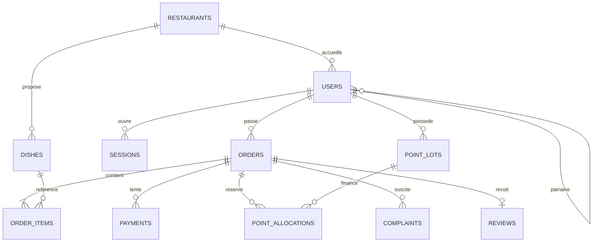

# Architecture de la version 0.1

## Technologies et circulation des données

React + Vite produit l’interface responsive. Express expose une API REST sous `/api`. La base conserve utilisateurs, sessions, catalogue, prix figés des commandes, tentatives de paiement, points, allocations, parrainages, réclamations, avis et journal d’audit. Le serveur Express sert aussi l’interface compilée : les cookies et les appels API restent sur la même origine.

La version locale utilise [PGlite](https://pglite.dev/docs/), PostgreSQL embarqué et persistant. `DATABASE_URL` permet d’utiliser PostgreSQL avec le pilote `pg`. Le schéma SQL est identique. Le test avec un serveur PostgreSQL externe reste à effectuer. PGlite possède une seule connexion ; son API de transaction met les opérations en file. En PostgreSQL externe, un verrou consultatif transactionnel global sérialise les écritures métier de cette première installation.

Chaque compte, commande et article contient `restaurant_id`. Les restaurants possèdent un identifiant unique et un lien `/r/identifiant`. L’API résout cet identifiant puis vérifie que la session appartient au même restaurant. Toutes les requêtes du catalogue, des commandes, des statistiques, de l’équipe et des paramètres sont limitées à cet espace. Une adresse e-mail peut avoir des comptes distincts grâce à la contrainte unique `(restaurant_id,email)`. La création d’un espace et de son premier administrateur est transactionnelle.

## Relations principales

Le schéma exécutable est `backend/sql/001_initial.sql`. Il est réexécutable au démarrage sans effacer les données. Toute évolution de structure devra ajouter une migration numérotée ; ne pas modifier les tables manuellement sur une base partagée.

## Sécurité appliquée

Mots de passe scrypt avec sel individuel, sessions aléatoires stockées sous forme de condensat SHA-256, cookies HttpOnly/SameSite et Secure en production. Le serveur contrôle les rôles et la propriété de chaque commande. Les formulaires ne peuvent pas fournir leur propre rôle ou prix. Les requêtes SQL sont paramétrées ; Zod valide les entrées. Les demandes de modification exigent un en-tête dédié et une origine configurée ; aucun CORS externe n’est activé. Helmet ajoute les en-têtes de sécurité et une CSP. Les réponses API ne sont pas mises en cache. Les limites de requêtes protègent notamment la connexion et la récupération.

Les photos sont décodées, limitées à 16 millions de pixels, recadrées en 256 × 256 et réencodées en WebP sans métadonnées. SVG et documents sont refusés. L’image normalisée est conservée dans la base pour simplifier la sauvegarde locale.

Les liens de récupération sont hachés en base, expirent en 30 minutes, ne fonctionnent qu’une fois et invalident les sessions. En local ils sont déposés dans `data/outbox`, répertoire privé ignoré par Git. L’envoi réel d’e-mails n’est pas implémenté et la demande est bloquée en production.

## Commandes, points et paiement

`requestKey` et une contrainte unique empêchent la duplication d’une commande après une double demande. Le serveur relit les prix et disponibilités dans la transaction. Les lignes conservent nom, prix et quantité : les changements futurs du catalogue ne réécrivent pas l’historique.

Les points sont détenus dans des lots datés, consommés par date d’expiration. La commande réserve les points dans la même transaction que son insertion. Une annulation non payée restitue les allocations une seule fois ; les points expirés restent exclus du solde. Le paiement confirmé change l’état de la commande, sans lui attribuer de points. Seul le service/livraison final crédite les points ; la source unique d’un lot empêche le double crédit. Le parrain reçoit son bonus une seule fois lors de la première commande honorée du filleul.

Les frais de livraison ne génèrent pas de points. Valeurs initiales configurables : 3 000 CDF par point gagné, 15 points pour 3 000 CDF de réduction, 5 points pour un parrainage, validité 365 jours, frais 2 000 CDF. Le cahier donne des exemples pour les taux et l’expiration ; ces valeurs sont des choix de démonstration à valider. Les futures attributions utilisent les paramètres au moment du service ; les totaux déjà créés ne sont pas recalculés.

Les paiements sont exclusivement simulés. Les appels `/simulate` sont indisponibles hors mode démonstration. `PAYMENT_MODE=live` ne déclenche aucun appel EasyPay dans cette version. Il renvoie une indisponibilité explicite. Aucun contrat d’API fournisseur n’a été inventé.

## Exploitation à préparer

Avant ouverture publique : PostgreSQL externe vérifié, HTTPS et origine publique, stockage/sauvegardes avec restauration testée, nettoyage périodique des sessions/liens expirés, serveur e-mail, validation juridique et tests multi-navigateurs. Le limiteur en mémoire devra utiliser un magasin partagé si plusieurs processus sont déployés. Un système de fichiers local ou PGlite ne doit pas être placé sur une plateforme à disque éphémère.

Sources techniques consultées le 23 octobre 2026 : [Vite](https://vite.dev/guide/), [PGlite](https://pglite.dev/docs/), [Express](https://expressjs.com/en/advanced/best-practice-security/). Les dépendances réellement utilisées sont figées dans `package-lock.json`.

## Personnalisation et équipe

Les informations publiques du restaurant sont conservées dans `restaurants.branding` (logo, images d’accueil, textes et contacts publics). Les images JPEG/PNG/WebP sont normalisées en WebP côté serveur, limitées à 3 Mo et 16 millions de pixels en entrée. Elles restent dans la base et sont livrées avec le catalogue public. Les informations personnelles du compte propriétaire ne sont pas publiées automatiquement. Seul un administrateur du restaurant peut modifier cette identité.

L’administrateur crée et modifie des employés ou gérants. Le gérant crée uniquement des employés. Aucun de ces formulaires ne permet de créer un administrateur dans un restaurant existant. Le nouveau parcours public crée un administrateur uniquement dans un nouvel espace. Les migrations 002 et 003 sont réexécutables et conservent les données existantes.

## Affiches et corrections de points

Le module engagement.js gère les affiches par restaurant, les participations uniques par étudiant et événement et le journal des corrections. Les mutations métier sont transactionnelles : contrôle de capacité sous verrou d’affiche, correction de points et audit atomiques, consommation des lots disponibles par expiration. Les réservations de commande sont conservées. Les corrections sont idempotentes par administrateur et clé de demande. La migration 006 est réexécutable sans effacement.
